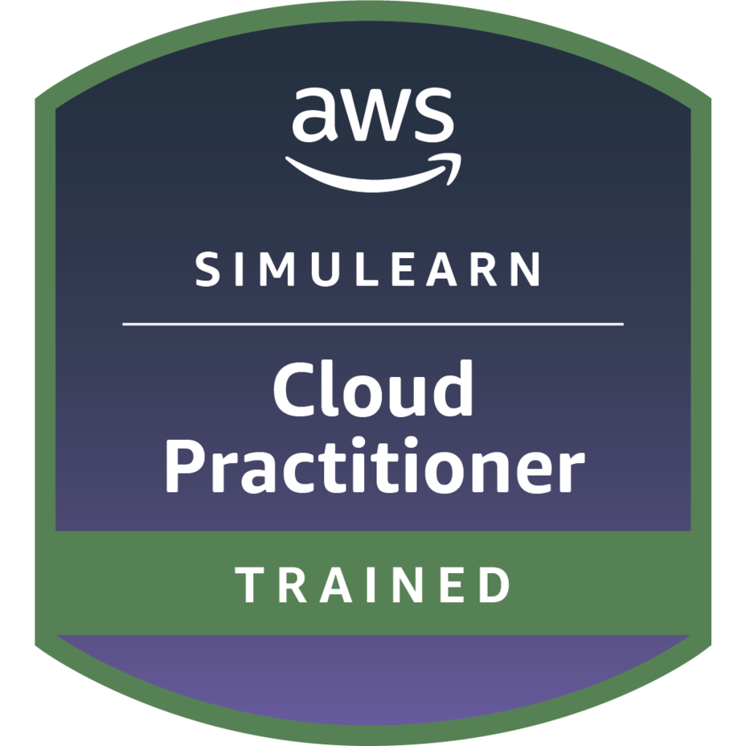

# 🎓 Certifications & Badges

[← Back to the main portfolio](../README.md)

This page brings together the digital badges and training records I've earned through my AWS re/Start journey and independent study, with a link to verify each one. They show my progress from cloud fundamentals towards the AWS Certified Cloud Practitioner exam, which I'm currently preparing for.

| Badge | Credential | Issuer | Verification |
|---|---|---|---|
|  | AWS SimuLearn: Cloud Practitioner Trained | AWS Training & Certification | [View on Credly](https://www.credly.com/badges/281e7218-2e16-45af-9e9d-ea57e87d4e6a/public_url) |
|  | AWS re/Start Graduate | AWS Training & Certification | [View on Credly](https://www.credly.com/badges/fee7e849-146d-41c3-8c61-e13a63e83073/public_url) | 

**In progress:** AWS Certified Cloud Practitioner (exam preparation underway)

---

## 🎮 AWS SimuLearn Completions

Scenario-based, hands-on training completed through AWS SimuLearn as part of my AWS re/Start journey.

| Assignment | Focus Area | Completed | Evidence |
|---|---|---|---|
| Cloud First Steps | **Cloud Fundamentals** | June 2, 2026 | [View certificate](./SimuLearn/CC_Cloud_First_Steps.pdf) |
| Cloud Computing Essentials | **Cloud Fundamentals** | June 3, 2026 | [View certificate](./SimuLearn/CC_Cloud_Computing_Essentials.pdf) |
| Cloud Economics | **Cost Management** | June 3, 2026 | [View certificate](./SimuLearn/CC_Cloud_Economics.pdf) |
| Highly Available Web Applications | **Cloud Architecture** | June 5, 2026 | [View certificate](./SimuLearn/CC_Highly_Available_Web_Applications.pdf) |
| Auto-Healing and Scaling Applications | **Cloud Architecture** | September 29, 2026 | [View certificate](./SimuLearn/CC_Scaling_Healing.pdf) |
| Computing Solutions | **Compute** | June 18, 2026 | [View certificate](./SimuLearn/CC_Computing_Solutions.pdf) |
| File Systems in the Cloud | **Storage** | July 9, 2026 | [View certificate](./SimuLearn/CC_File_Systems.pdf) |
| Databases in Practice | **Databases** | July 24, 2026 | [View certificate](./SimuLearn/CC_Databases_in_Practice.pdf) |
| First NoSQL Database | **Databases** | August 9, 2026 | [View certificate](./SimuLearn/CC_NoSQL.pdf) |
| Networking Concepts | **Networking** | August 7, 2026 | [View certificate](./SimuLearn/CC_Networking_Concepts.pdf) |
| Connecting VPCs | **Networking** | August 27, 2026 | [View certificate](./SimuLearn/CC_Connect_VPC.pdf) |
| Core Security Concepts | **Security** | August 20, 2026 | [View certificate](./SimuLearn/CC_Security_Concepts.pdf) |
| Use AI Services with Amazon SageMaker | **Machine Learning & AI** | September 20, 2026 | [View certificate](./SimuLearn/CC_AI_Services_SM.pdf) |
| Create an AI Smart Assistant | **Machine Learning & AI** | September 20, 2026 | [View certificate](./SimuLearn/CC_Create_Smart_Assistant.pdf) |
