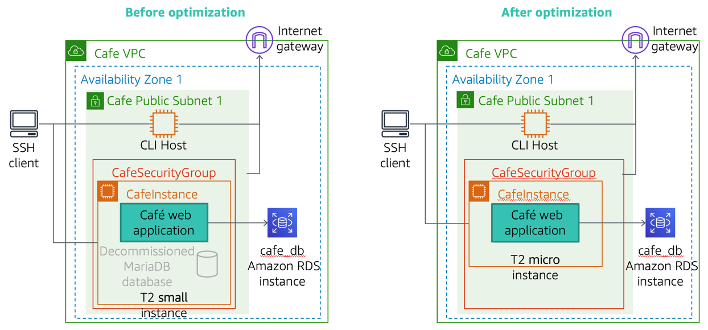
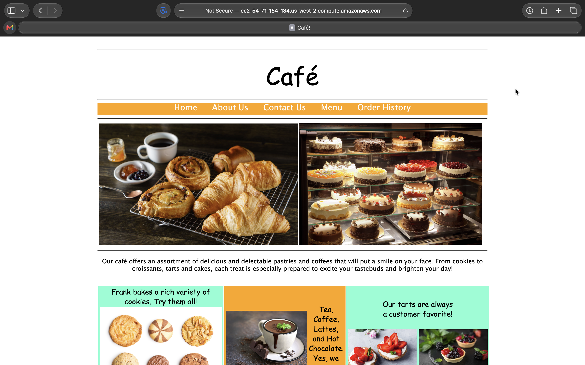
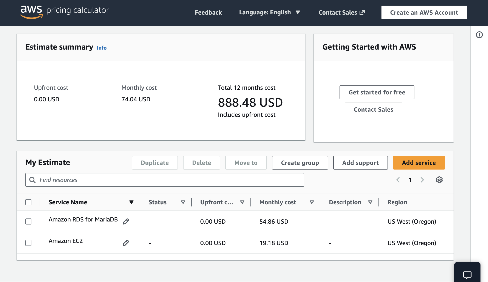
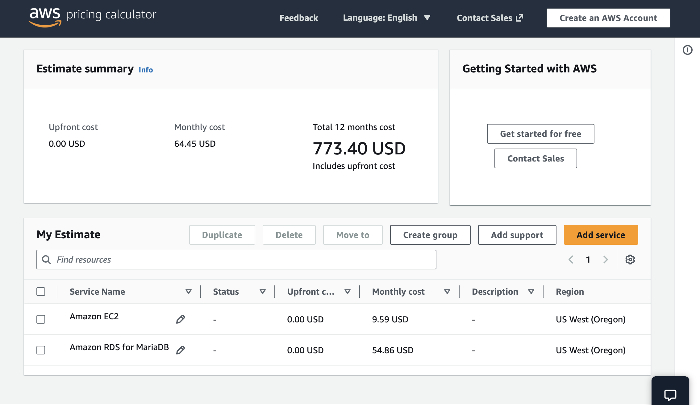

# Optimize Utilization

In this activity, I optimize the AWS resources used to run the Café web application. I first uninstall the decommissioned local database from the Café instance to decrease its storage requirements, then change the instance type to T3 micro to reduce costs.

<p align="center">
  
</p>

*This diagram illustrates the topology of the Café web application runtime environment before and after the optimization.*

## Business case relevance

### A new business requirement for Café — Optimize resources to reduce AWS service costs

<p align="center">
  
</p>

After the migration to Amazon Relational Database Service (Amazon RDS) was completed (an action taken in a prior activity), Sofîa identifies a number of optimization opportunities she can implement to reduce AWS service costs. First, she realizes that the decommissioned local database can be uninstalled to reduce the storage requirements of the Café instance. She also realizes that the Café instance can be downsized to a smaller instance type, since the database process is no longer running on it.

In this activity, I take on the role of Sofîa, working to optimize the Café instance to save costs.

## Task 1: Optimize the website to reduce costs

Because the local database was migrated to Amazon RDS, I can reduce AWS service costs by performing the following actions on the `Café` EC2 instance:

* Remove the local database from the instance — this reduces costs in both CPU and storage utilization
* Change the instance type from `t3.small` to `t3.micro` — since the database process no longer runs on the instance, the smaller instance type is both effective and cheaper to run

### Task 1.1: Connect to the Café instance by using SSH

In this task, I connected to the `Café` EC2 instance using SSH to perform optimization steps.

I established an SSH connection to the Cafe Instance using the provided key pair and public IP address `54.212.10.250`.
```bash
kylescritten@Kyles-MacBook-Air ~ % cd ~/Downloads
kylescritten@Kyles-MacBook-Air Downloads % chmod 400 labsuser.pem
kylescritten@Kyles-MacBook-Air Downloads % ssh -i labsuser.pem ec2-user@54.212.10.250
The authenticity of host '54.212.10.250 (54.212.10.250)' can't be established.
ED25519 key fingerprint is: SHA256:nBA1T2qQn5SLqCwUlwcyF6gzYDLGUbDIrOmhwoVjoaU
This key is not known by any other names.
Are you sure you want to continue connecting (yes/no/[fingerprint])? yes
Warning: Permanently added '54.212.10.250' (ED25519) to the list of known hosts.
** WARNING: connection is not using a post-quantum key exchange algorithm.
** This session may be vulnerable to "store now, decrypt later" attacks.
** The server may need to be upgraded. See https://openssh.com/pq.html
   ,     #_
   ~\_  ####_        Amazon Linux 2
  ~~  \_#####\
  ~~     \###|       AL2 End of Life is 2026-06-30.
  ~~       \#/ ___
   ~~       V~' '->
    ~~~         /    A newer version of Amazon Linux is available!
      ~~._.   _/
         _/ _/       Amazon Linux 2023, GA and supported until 2029-06-30.
       _/m/'           https://aws.amazon.com/linux/amazon-linux-2023/

[ec2-user@web-server ~]$ 
```

I also configured the AWS CLI by setting the `access key`, `secret key`, `region`, and `default output format` from the lab credentials provided.
```bash
[ec2-user@web-server ~]$ curl http://169.254.169.254/latest/dynamic/instance-identity/document | grep region
  % Total    % Received % Xferd  Average Speed   Time    Time     Time  Current
                                 Dload  Upload   Total   Spent    Left  Speed
100   475  100   475    0     0   128k      0 --:--:-- --:--:-- --:--:--  154k
  "region" : "us-west-2",
[ec2-user@web-server ~]$ aws configure
AWS Access Key ID [None]: <Access Key>
AWS Secret Access Key [None]: <Secret Access Key>
Default region name [None]: us-west-2
Default output format [None]: json
```

### Task 1.2: Connect to the CLI Host instance by using SSH

In this task, I connected to the `CLI Host` using SSH to perform optimization steps.

Next, I opened a second SSH session to the `CLI Host` Instance using the provided key pair and public IP address `44.248.50.221` and configured the AWS CLI there as well.
```bash
kylescritten@Kyles-MacBook-Air ~ % cd ~/Downloads
kylescritten@Kyles-MacBook-Air Downloads % chmod 400 labsuser.pem
kylescritten@Kyles-MacBook-Air Downloads % ssh -i labsuser.pem ec2-user@44.248.50.221
The authenticity of host '44.248.50.221 (44.248.50.221)' can't be established.
ED25519 key fingerprint is: SHA256:ZfsmE56V0iuHgzCbUgs/nxYeQEPTbur637GZB11EFKc
This key is not known by any other names.
Are you sure you want to continue connecting (yes/no/[fingerprint])? yes
Warning: Permanently added '44.248.50.221' (ED25519) to the list of known hosts.
** WARNING: connection is not using a post-quantum key exchange algorithm.
** This session may be vulnerable to "store now, decrypt later" attacks.
** The server may need to be upgraded. See https://openssh.com/pq.html
   ,     #_
   ~\_  ####_        Amazon Linux 2
  ~~  \_#####\
  ~~     \###|       AL2 End of Life is 2026-06-30.
  ~~       \#/ ___
   ~~       V~' '->
    ~~~         /    A newer version of Amazon Linux is available!
      ~~._.   _/
         _/ _/       Amazon Linux 2023, GA and supported until 2029-06-30.
       _/m/'           https://aws.amazon.com/linux/amazon-linux-2023/

[ec2-user@cli-host ~]$ aws configure
AWS Access Key ID [None]: <Access Key>
AWS Secret Access Key [None]: <Secret Access Key>
Default region name [None]: us-west-2
Default output format [None]: json
[ec2-user@cli-host ~]$ 
```

### Task 1.3: Uninstall MariaDB and resize the instance

I stopped and uninstalled the local MariaDB database from the Café instance, in the **SSH window for the `CafeInstance`**, using the following commands:
```bash
[ec2-user@web-server ~]$ sudo systemctl stop mariadb
[ec2-user@web-server ~]$ sudo yum -y remove mariadb-server
...
Complete!
```

*If the last command runs successfully, you will see a **Complete!** message in the output.*

I close the **SSH window for the Café instance** because I no longer need it.

Next, I determine the Instance ID of the Café instance. I switch to the **SSH window for the CLI Host instance** and enter the following command:
```bash
[ec2-user@cli-host ~]$ aws ec2 describe-instances \
> --filters "Name=tag:Name,Values= CafeInstance" \
> --query "Reservations[*].Instances[*].InstanceId"
[
    [
        "i-072ae59d131f2c334"
    ]
]
```

*I record the value returned as:*
```
CafeInstance Instance ID: i-072ae59d131f2c334
```

Then, I stop the Café instance and change its instance type to `t3.micro` by running the following commands:
```bash
[ec2-user@cli-host ~]$ aws ec2 stop-instances --instance-ids i-072ae59d131f2c334
{
    "StoppingInstances": [
        {
            "InstanceId": "i-072ae59d131f2c334", 
            "CurrentState": {
                "Code": 64, 
                "Name": "stopping"
            }, 
            "PreviousState": {
                "Code": 16, 
                "Name": "running"
            }
        }
    ]
}
[ec2-user@cli-host ~]$ 
[ec2-user@cli-host ~]$ 
[ec2-user@cli-host ~]$ aws ec2 modify-instance-attribute \
> --instance-id i-072ae59d131f2c334 \
> --instance-type "{\"Value\": \"t3.micro\"}"
```

*If the command completes successfully, no output is returned*

I restarted the Cafe instance, by running the following:
```bash
[ec2-user@cli-host ~]$ aws ec2 start-instances --instance-ids i-072ae59d131f2c334
{
    "StartingInstances": [
        {
            "InstanceId": "i-072ae59d131f2c334", 
            "CurrentState": {
                "Code": 0, 
                "Name": "pending"
            }, 
            "PreviousState": {
                "Code": 80, 
                "Name": "stopped"
            }
        }
    ]
}
```

Finally, I verified that the instance was running again:
```bash
[ec2-user@cli-host ~]$ aws ec2 describe-instances \
> --instance-ids i-072ae59d131f2c334 \
> --query "Reservations[*].Instances[*].[InstanceType,PublicDnsName,PublicIpAddress,State.Name]"
[
    [
        [
            "t3.micro", 
            "ec2-54-71-154-184.us-west-2.compute.amazonaws.com", 
            "54.71.154.184", 
            "running"
        ]
    ]
]
```

>[!Note]
> Because I restarted the instance, Amazon EC2 assigns a different **Public DNS name** and **Public IP address** to the instance than it had before.

The instance might take a few moments to reach the **running** state. I record the `PublicDnsName` and `PublicIPAddress` values returned by the command in the following format:

```
Downsized CafeInstance Public DNS Name: ec2-54-71-154-184.us-west-2.compute.amazonaws.com

Downsized CafeInstance Public IP Address: 54.71.154.184
```

I tested the Café website to make sure it is functional. In a browser window, I enter the following URL:

```
http://ec2-54-71-154-184.us-west-2.compute.amazonaws.com/cafe
```

<p align="center">
  
</p>

*Exercise the website's functions to verify that it works properly. I have successfully uninstalled the decommissioned local database and downsized the Café instance.*

## Task 2: Use the AWS Pricing Calculator to estimate AWS service costs

AWS provides a tool that allows me to estimate the monthly costs of the AWS services I use or am planning to use. In this task, I use the [AWS Pricing Calculator](https://calculator.aws) to estimate the cost of running the Café website on AWS before and after EC2 instance optimization, then calculate the projected cost savings.

### Task 2.1: Calculate the costs before optimization

First, I calculate the costs of running the website in its before-optimization topology — that is, on a `t3.small` instance with a decommissioned local database still occupying storage space.

I use the following service list and configuration to describe the topology components:

* **Region:** The Region where the Café instance EC2 instance is running
* **Amazon EC2 instance:**
   * Instance type: `t3.small`
   * Instance class: On-Demand
   * Utilization: 100% per month
   * Operating system: Linux
   * Amazon EBS volume: General Purpose SSD (gp2), 40 GB (including 20 GB occupied by the local database)
* **Amazon RDS instance:**
   * Instance class: `db.t3.micro`
   * Engine: MariaDB
   * Allocated storage: 20 GB

<p align="center">
  
</p>

```
AWS Services Before Optimization Estimated Monthly Cost: $ 74.04
```

### Task 2.2: Calculate the costs after optimization

Next, I calculate the costs of running the website after the Café instance was optimized. I modify the following entries in the calculator to reflect the effects of the optimization:

* **Amazon EC2 instance:**
   * Instance type: `t3.micro` (reduced size)
   * Amazon Elastic Block Store (Amazon EBS): `General Purpose SSD (gp2), 20 GB` (reduced from 40 GB because the local database was removed)
* **Amazon RDS instance:**
   * No changes are made.

<p align="center">
  
</p>

```
AWS Services After Optimization Estimated Monthly Cost: $ 64.45
```

### Task 2.3: Estimate the projected cost savings for Café

I calculated the costs of the AWS services that were needed to run the Café website both before and after I optimize the instance. Therefore, I can estimate the overall projected cost savings as follows:

```
Before optimization monthly costs:
    - Amazon EC2 service         $ 19.18
    - Amazon RDS service         $ 54.86
                                --------
    Total                        $ 74.04

After optimization monthly costs:
    - Amazon EC2 service         $ 9.59
    - Amazon RDS service         $ 54.86
                                --------
    Total                        $ 64.45


Overall monthly cost savings      $ 9.59
```

*By removing the decommissioned local database and downsizing the Café instance type, the project will save about $9.59 per month in AWS service costs.*

## Business case feedback

### Update from Café

<p align="center">
  
</p>

Martha and Frank are very happy that Sofîa's initiative resulted in cost savings for the business. The amount of savings might be small, but it still helps the business!

## Conclusion

In this lab, I successfully optimized the Café web application infrastructure by removing an unused local database and downsizing the EC2 instance. 
These changes reduced both compute and storage costs without affecting application functionality.

Using the AWS Pricing Calculator, I confirmed that the optimizations resulted in an estimated monthly savings of $10.42. This exercise demonstrated 
how small architectural improvements can lead to meaningful cost reductions in cloud environments while maintaining performance and reliability.

After completing this activity, I am able to:
* I **optimized** an Amazon Elastic Compute Cloud (Amazon EC2) instance to reduce costs.
* I **used** the AWS Pricing Calculator to estimate AWS service costs.


## Bash Commands

```bash
# Stop the MariaDB service on the CafeInstance
sudo systemctl stop mariadb

# Remove the MariaDB server package from the CafeInstance
sudo yum -y remove mariadb-server

# Retrieve the AWS region from the instance metadata
curl http://169.254.169.254/latest/dynamic/instance-identity/document | grep region

# Configure AWS CLI with credentials, region, and output format
aws configure

# Describe EC2 instances filtered by the CafeInstance tag to get the instance ID
aws ec2 describe-instances \
--filters "Name=tag:Name,Values= CafeInstance" \
--query "Reservations[*].Instances[*].InstanceId"

# Stop the CafeInstance EC2 instance (replace <instance-id> with actual ID)
aws ec2 stop-instances --instance-ids <instance-id>

# Modify the instance type to t3.micro (replace <instance-id> with actual ID)
aws ec2 modify-instance-attribute \
--instance-id <instance-id> \
--instance-type "{\"Value\": \"t3.micro\"}"

# Start the CafeInstance EC2 instance (replace <instance-id> with actual ID)
aws ec2 start-instances --instance-ids <instance-id>

# Check instance details including type, DNS, IP, and status (replace <instance-id>)
aws ec2 describe-instances \
--instance-ids <instance-id> \
--query "Reservations[*].Instances[*].[InstanceType,PublicDnsName,PublicIpAddress,State.Name]"
```
