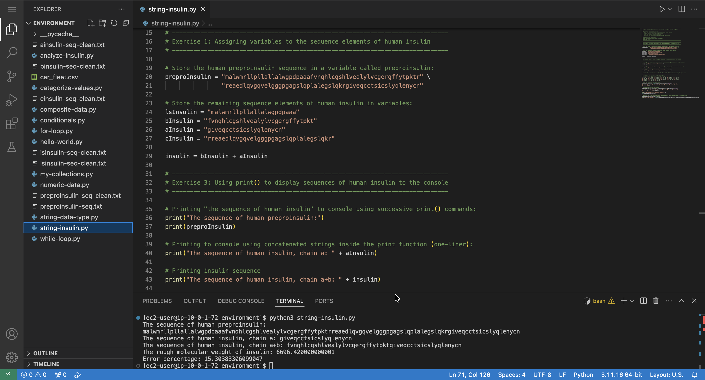

# Working with the String Sequence and Numeric Weight of Insulin in Python

## Lab overview

I apply what I have learned to the real-world application of human insulin. I store the protein sequence of human preproinsulin in a string variable and the weight of preproinsulin in `int` and `float` variables. Next, I print these variables to the console, with comments that explain the code, and perform basic math and string concatenations.

## Solution

The full script for this lab is available here: [string-insulin.py](./python-scripts/string-insulin.py)

  

## Conclusion

After successfully completing this lab, I am able to:

* Add comments that explain the intention and flow of my code
* Use `print()` to print elements of my Python code to the console
* Use string manipulations to get the sequence of insulin from preproinsulin
* Do basic math on the molecular weight and sequence of insulin
* Assign string, int, and float variables to numbers that represent the weight of insulin
* Explore Python exceptions
