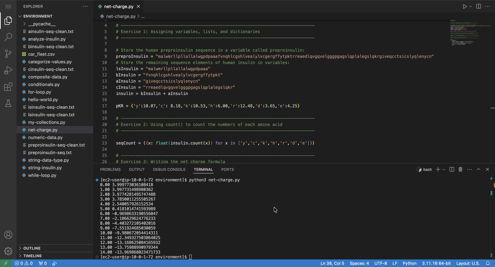

# Calculating the Net Charge of Insulin by Using Python Lists and Loops

## Lab overview

In a previous module, I learned about `if-else` statements, `while` loops, lists, and `for` loops. Now I apply what I have learned to the real-world application of human insulin.

Here, I use lists, `for` and `while` loops, and basic math to calculate the net charge of insulin from pH 0 to pH 14.

## Solution: Net Charge of Insulin

The full script for this lab is available here: [net-charge.py](./python-scripts/net-charge.py)

This program calculates the net charge of insulin from pH 0 to 14 based on the ionization of amino acids.

Net Charge = positive residues (K, H, R) − negative residues (Y, C, D, E)

The charge varies with pH:
- Low pH → positive charge
- High pH → negative charge
- Net charge = 0 → isoelectric point (pI)

  

## Conclusion

After completing this lab, I am able to:

* Create a dictionary of pKa values (which indicate the strength of an acid) used in the net charge calculations
* Use the `count()` method to get a count of amino acids
* Use a `while` loop to calculate the net charge of insulin from pH 0 to pH 14
