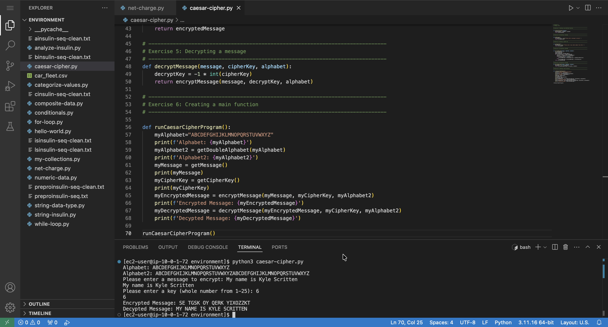

# Using Functions to Implement a Caesar Cipher

## Lab overview

In programming, a function is a named section of a program that performs a specific task. Python has built-in functions like `print()` that are provided by the language. Additionally, I can use functions provided by other developers through the `import` statement — for example, `import math` if I want to use the `math.floor()` function. In Python, I can also make my own functions, called user-defined functions.

To drive the discussion of user-defined functions, I write a program that implements a Caesar cipher, a simple method of encryption. A Caesar cipher takes the letters of a message and shifts each letter along the alphabet by a certain number of places.

## Solution: Caesar Cipher Program

The full script for this lab is available here: [caesar-cipher.py](./python-scripts/caesar-cipher.py)

This program implements a simple Caesar cipher to encrypt and decrypt messages.

The Caesar cipher is a substitution cipher where each letter in a message is shifted by a fixed number of positions in the alphabet. The shift value is defined by the user as the cipher key.

### How it works

1. The program defines the alphabet and creates a duplicated version to handle letter shifting.
2. The user inputs a message and a cipher key (shift value between 1 and 25).
3. The message is converted to uppercase for consistency.
4. Each letter in the message is shifted forward in the alphabet to create the encrypted message.
5. Non-alphabet characters (e.g., spaces, punctuation) remain unchanged.
6. The encrypted message is then decrypted by shifting letters backward using the same key.

### Key concepts

- Encryption: Shift letters forward
- Decryption: Shift letters backward
- The same key is used for both operations

  

## Conclusion

After completing this lab, I am able to:

* Create user-defined functions
* Use several functions to implement a Caesar cipher encryption program
