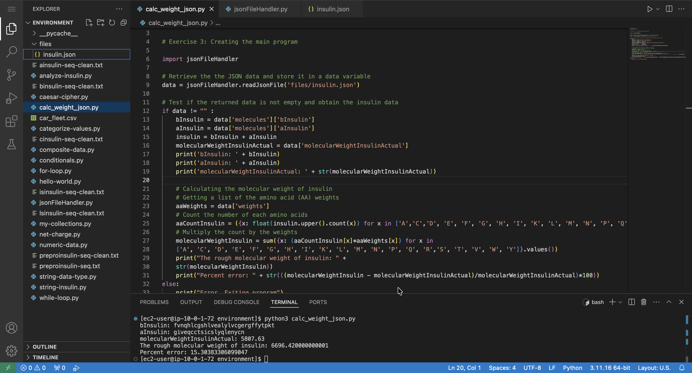

# Creating File Handlers and Modules for Retrieving Information about Insulin

This lab demonstrates how to use Python to process biological data by reading insulin sequences from a JSON file and calculating their molecular weight.

## Solution

I create the JSON molecules data file [insulin.json](./files/insulin.json) and place it in the `files` subfolder. This JSON document stores all the information from the previous lab, such as the insulin molecules, the numeric weights of the amino acids, and the actual weight of the insulin molecule.

The Python files for this lab are:
- [calc_weight_json.py](./python-scripts/calc_weight_json.py)
- [jsonFileHandler.py](./python-scripts/jsonFileHandler.py)

These programs calculate the molecular weight of insulin using data stored in a JSON file.

### How the Program works

- Reads insulin data (A chain, B chain, amino acid weights, and actual molecular weight) from `insulin.json`
- Combines the A and B chains to form the full insulin sequence
- Counts the occurrence of each amino acid
- Calculates the molecular weight by summing the weights of all amino acids
- Compares the result with the actual value and computes the percent error

  

## Conclusion

After completing this lab, I am able to:
- Create a module
- Open a file and load the JSON data it contains using the built-in JSON module of Python
- Parse the JSON structure to access insulin data
- Calculate the rough molecular weight of human insulin using given code (similar to the lab Working with the String Sequence and Numeric Weight of Insulin in Python)
