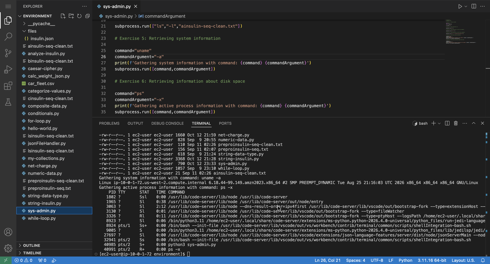

# Introducing System Administration with Python

## Lab overview

I can use Linux to do many administrative tasks from the terminal, or the Bash command line. Python provides several modules that I can also use to run commands on the command line. In this lab, I use `os.system()` and `subprocess.run()` to run Bash commands from Python.

## Solution

The full script for this lab is available here: [sys-admin.py](./python-scripts/sys-admin.py).

The program uses two approaches to run system commands:

1. `os.system()` to execute a simple command (`ls`) and display directory contents
2. `subprocess.run()` to execute more flexible and secure system commands

The script runs several Linux commands:

- `ls` → lists files in the current directory
- `ls -l` → displays detailed file information
- `ls -l README.md` → checks details of a specific file
- `uname -a` → retrieves system information (kernel, OS, architecture)
- `ps -x` → displays currently running processes

  

## Conclusion

After completing this lab, I am able to:

* Use `os.system()` to run a Bash command
* Use `subprocess.run()` to run Bash commands
