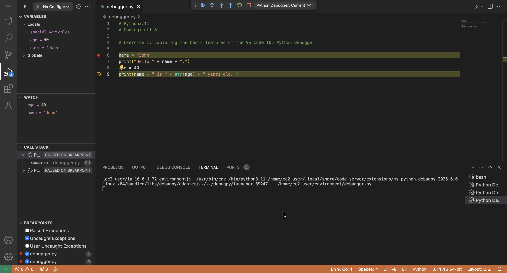
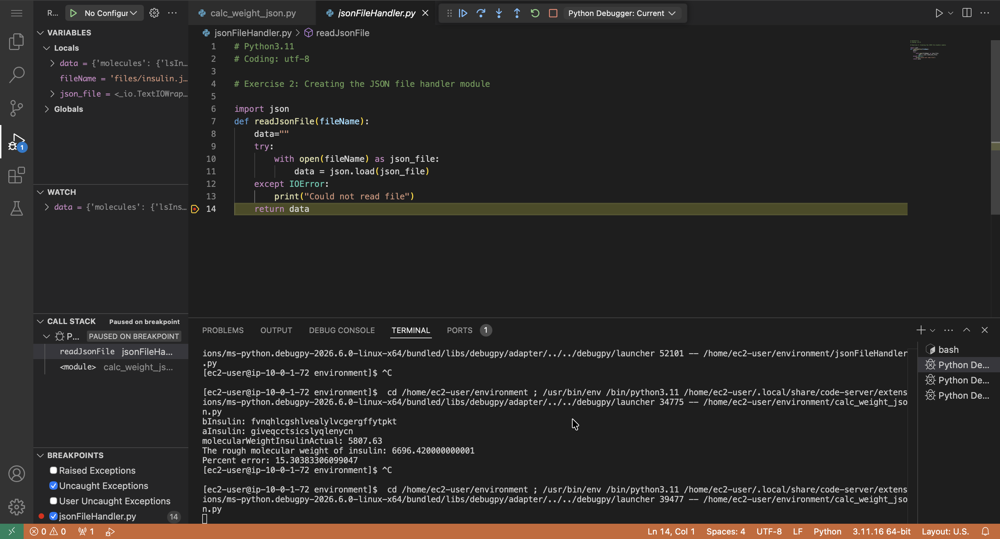

# Using the Debugger

## Lab overview

A *software bug* is an error, flaw, or failure in a computer program that causes an incorrect or unexpected result. A *debugger* is a computer program that I can use to test and find bugs (debug) in other programs. I can use a debugger to step through my code and examine how it executes. The Python Debugger (pdb) is an interactive source code debugger for Python programs. In this lab, I used `pdb` to step through the scripts I wrote in previous labs.

## Solution

The VS Code IDE provides an interactive source code debugger for several programming languages, including Python. In this exercise, I learned some of the basic commands for debugging a Python file.

The full script for this lab is available here: [debugger.py](./python-scripts/debugger.py)

  

I use the Python Debugger to step into the `jsonFileHandler.py` file while running `calc_weight_json.py` in debug mode.

  

## Conclusion

After completing this lab, I am able to:

* Explore the basic features of the Python Debugger
* Use the Python Debugger to step through Python scripts
