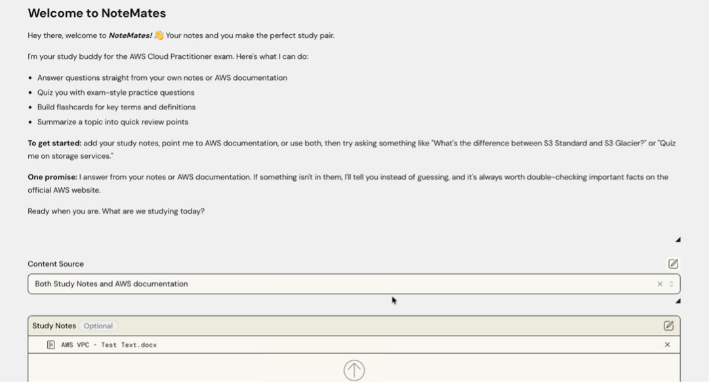
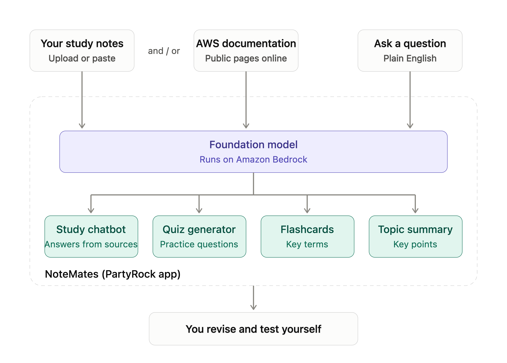
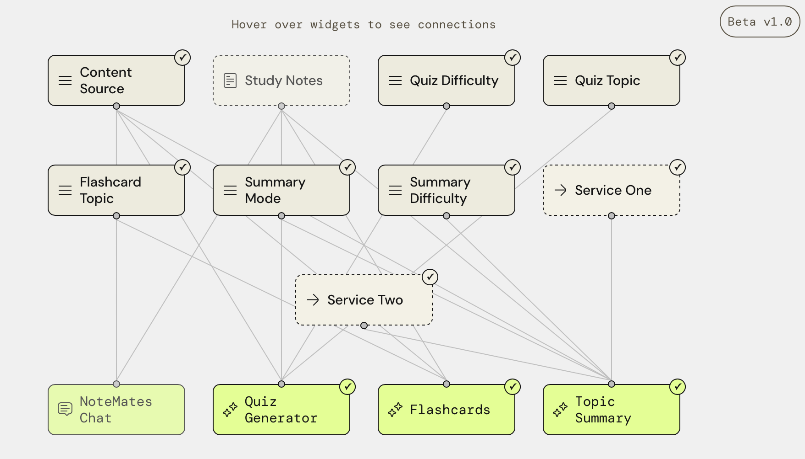
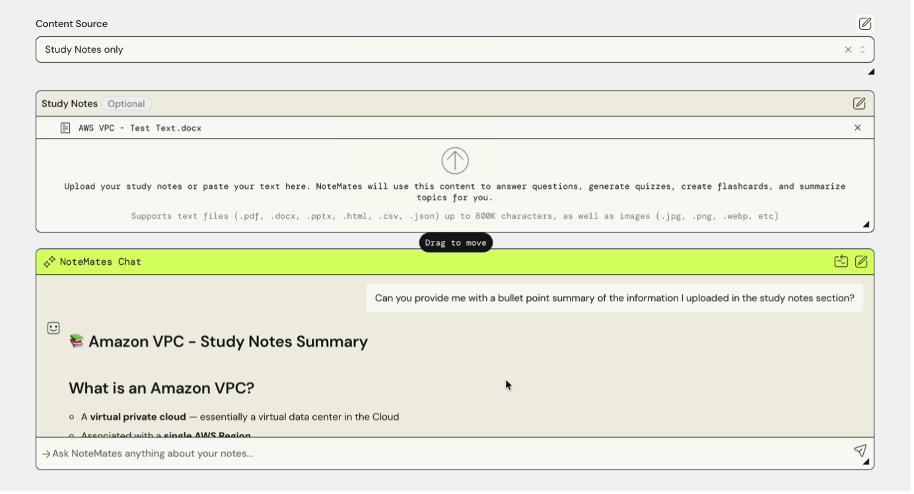
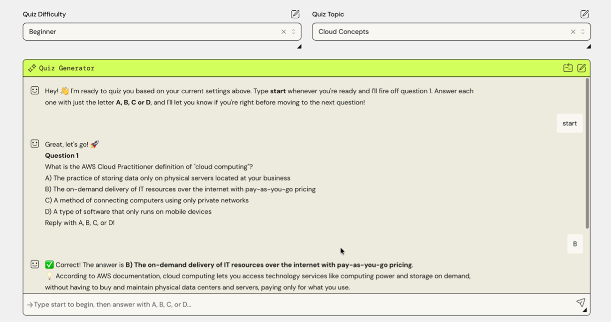
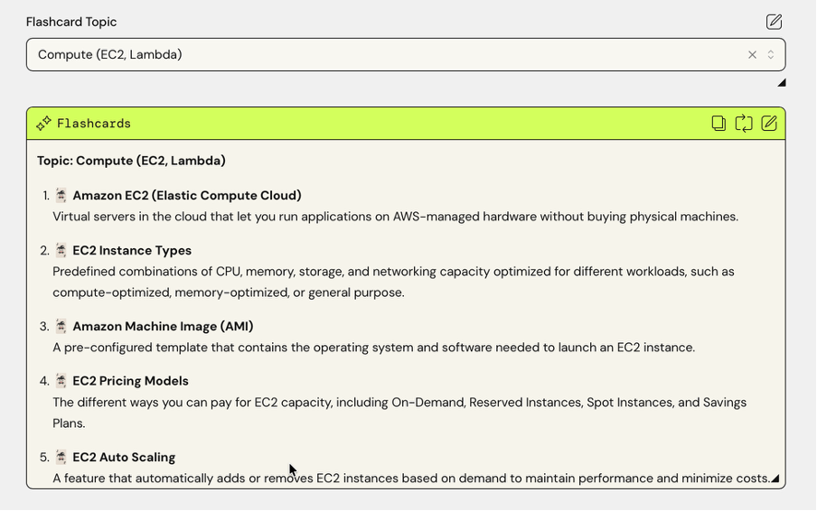
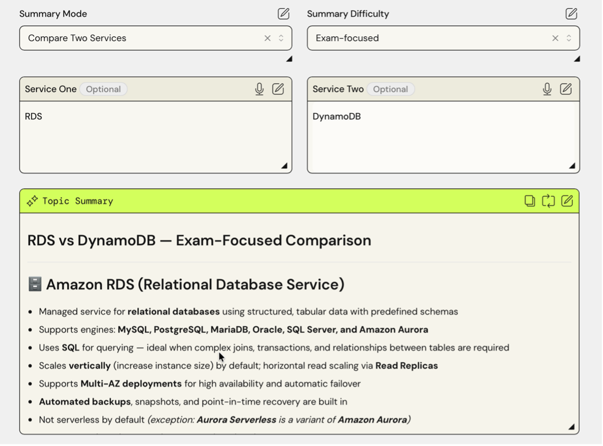
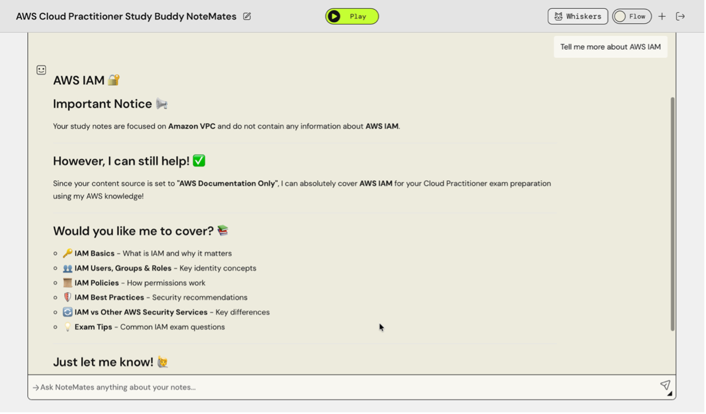

# NoteMates: An AI Study Buddy for the AWS Cloud Practitioner Exam
## A Generative AI Chatbot Built with AWS PartyRock and Amazon Bedrock

> [!NOTE]
> **📋 Project:** The Portfolio (Part 5): NoteMates AI App  
> **👨‍💻 Author:** Kyle Scritten  
> **🗓️ Submitted:** October 2026

---

## 📋 1. The Story

Students preparing for the AWS Cloud Practitioner exam collect notes from video lessons, documentation and practice quizzes, then lose time searching through them for a single answer. **NoteMates** turns those notes into something a student can talk to.

| Question | Answer |
| :--- | :--- |
| **Who is the customer?** | Students preparing for the AWS Cloud Practitioner exam, especially those working toward a professional career in cloud computing. |
| **Who is affected?** | The same students. Their notes pile up across documents, and finding one answer can take longer than learning it. |
| **What is the problem?** | Revision is slow and passive. Students end up rereading what they have written instead of testing what they know. |
| **What is being proposed?** | A **chatbot-led study app**. Students add their own notes, use AWS documentation, or combine both, then ask questions in plain English, take practice quizzes, review flashcards and get quick topic summaries. |
| **Why does the customer need it?** | It saves time searching, adds active practice to revision, and answers only from the chosen sources. If something isn't covered, NoteMates says so instead of guessing. |
| **How does it work?** | A foundation model running on Amazon Bedrock, driven by prompts and connected widgets in AWS PartyRock, generates answers, quizzes, flashcards and summaries from the selected source. |

---

## 🚀 2. Try the App

[**Open NoteMates in AWS PartyRock →**](https://partyrock.aws/u/kylescritten/KGSyvoxTD/AWS-Cloud-Practitioner-Study-Buddy-NoteMates)

*Figure 1. The NoteMates welcome message, Content Source dropdown and Study Notes upload area.*

**Getting started**

1. Choose a **Content Source**: Study Notes only, AWS documentation only, or both.
2. Optionally add your study notes by dragging a file into the Study Notes box. Leave it empty and NoteMates uses AWS documentation instead.
3. Ask a question in plain English, for example "What's the difference between S3 Standard and S3 Glacier?", or use the quiz, flashcard and summary widgets.

I tested the app with a short set of Amazon VPC study notes: [AWS-VPC-Test-Text.docx](./files/AWS-VPC-Test-Text.docx)

---

## ⚙️ 3. How It Works

NoteMates is built in **AWS PartyRock**, which runs on **Amazon Bedrock** foundation models. That let me focus on designing the experience, writing effective prompts, and checking the quality and responsibility of the AI's answers.

*Figure 2. How NoteMates turns a student's study notes, AWS documentation, or both into answers, quizzes, flashcards and summaries.*

Behind the scenes, the app is a set of connected PartyRock widgets. Input widgets (dropdowns and text boxes) feed the AI output widgets:

*Figure 3. How the NoteMates widgets are connected in PartyRock.*

| Output widget | Controlled by |
| :--- | :--- |
| **NoteMates Chat** | Content Source, Study Notes |
| **Quiz Generator** | Content Source, Study Notes, Quiz Difficulty, Quiz Topic |
| **Flashcards** | Content Source, Study Notes, Flashcard Topic |
| **Topic Summary** | Content Source, Study Notes, Summary Mode, Summary Difficulty, Service One, Service Two |

---

## ✨ 4. Features

### 4.1 Content Source and NoteMates Chat

The **Content Source** dropdown lets the student choose what NoteMates draws its answers from. The **NoteMates Chat** widget is where they talk to that material: type a question in plain English and the reply follows the selected source. In the example below, I asked for a bullet point summary of my uploaded notes and got a formatted summary of the Amazon VPC material, with a heading, bold key terms and bullets.

*Figure 4. The content source and NoteMates chat section.*

### 4.2 Generated Quiz

The student picks a **Quiz Difficulty** and a **Quiz Topic**, then types **start**. NoteMates runs a 10 question multiple choice quiz **one question at a time**. The student answers with the letter A, B, C or D, sees whether they were right with a short explanation, and moves on to the next question. A final score is given after 10 questions.

*Figure 5. The chat style quiz, set to Beginner difficulty and the Cloud Concepts topic.*

### 4.3 Flashcards

The student chooses a **Flashcard Topic** and the widget generates a numbered list of key terms with short plain language definitions. The **Refresh** button generates a new set for the same topic, so they can keep revising without repeating the same cards.

*Figure 6. Flashcards for the Compute (EC2, Lambda) topic.*

### 4.4 Topic Summary

**Summary Mode** offers three options: **Quick Review** (a short summary of key points), **Explain a Service** (a breakdown of one AWS service) and **Compare Two Services** (a side by side comparison). The optional **Service One** and **Service Two** boxes name the services to explain or compare.

*Figure 7. An exam focused comparison of RDS and DynamoDB.*

### 4.5 Difficulty Levels

The quiz and summary widgets share three difficulty levels:

| Level | What changes |
| :--- | :--- |
| **Beginner** | Simple language and core definitions, with no jargon. |
| **Intermediate** | Scenario based, focusing on how services connect. |
| **Exam-focused** | Wording that mirrors the real exam. Summaries also include plausible distractors and flag common traps. |

All AI widgets also have fallback logic: if "Study Notes only" is selected but nothing has been uploaded, they use AWS documentation instead of stalling.

---

## 💬 5. Prompts Used to Build the App

The app was created and refined through prompts. These are the prompts I used, in the order I used them.

**Creating the study chatbot**

> "You are NoteMates, a friendly study buddy for students preparing for the AWS Cloud Practitioner exam. Check @Study Notes. If it contains real study notes, answer using the notes first, and add AWS documentation knowledge only if the notes don't fully cover the question, saying which part came from where. If @Study Notes says "NO NOTES PROVIDED" or is empty, answer using AWS documentation instead and begin with "No notes added, so I'm using AWS documentation." Keep answers short and clear, in simple language. If you aren't sure of an answer, say so instead of guessing."

**Creating the quiz generator** *(the first version asked for 5 questions, which I later increased to 10)*

> "Check @Study Notes. If it contains real study notes, create 5 multiple-choice questions based on them. If it says "NO NOTES PROVIDED" or is empty, create 5 questions based on AWS Cloud Practitioner exam topics from AWS documentation, and begin with "No notes added, so these questions come from AWS documentation." Use exam-style wording, give four options (A-D), mark the correct answer, and add a one-sentence explanation."

**Implementing the flashcards feature**

> "Check @Study Notes. If it contains real study notes, list the 10 most important terms from them. If it says "NO NOTES PROVIDED" or is empty, list 10 key AWS Cloud Practitioner terms from AWS documentation and begin with "No notes added, so these come from AWS documentation." For each term, give a one-sentence definition in plain language."

**Fixing the stalling issue across widgets**

> "The app should not wait for @Study Notes to get started in the other widgets. If nothing is uploaded in the @Study Notes widget then AWS Documentation should automatically be used"

**Adding a topic summary section**

> "Check @Study Notes. If it contains real study notes, summarize them into 5-7 key review points. If it says "NO NOTES PROVIDED" or is empty, ask the user to type a topic, or if none is given, summarize the core AWS Cloud Practitioner exam domains from AWS documentation, beginning with "No notes added, so this summary comes from AWS documentation." Use short bullet points and bold the key AWS service names."

**Updating difficulty across sections**

> "The difficulty mode selection options are Foundational, Associate, and Professional which is more working-professional focused. This needs to be replaced by Beginner, Intermediate, and Exam-focused across all relevant widgets with a difficulty dropdown because this is aimed at students working towards their professional careers."

**Increasing the number of quiz questions**

> "The Generated Quiz is only 5 multiple choice questions, and I would like this to be 10."

**Making the quiz generator more interactive**

> "Change the @Quiz Generator widget to make it more interactive by allowing the user to select an option before displaying the correct answer and one line explanation and moving onto the next question"

---

## 🧪 6. Model Testing

I tested the chatbot in three ways to check that its answers stay grounded in the source it was given: a question answered from my uploaded notes, the same question with no notes, and a question my notes don't cover.

| Test | Question | What happened |
| :--- | :--- | :--- |
| **1. From my notes** (Study Notes only) | Does Amazon VPC span across multiple regions? | **Matched my notes.** NoteMates answered no, quoted the notes ("An Amazon VPC lives in one Region"), and added a quick VPC, subnet and route table breakdown with an exam tip. |
| **2. Same question, no notes** (AWS documentation only) | Does Amazon VPC span across multiple regions? | **Same correct answer from AWS documentation.** A VPC is limited to a single Region, with subnets spread across Availability Zones inside it. |
| **3. Outside my notes** | Tell me more about AWS IAM? | **Fell back to AWS documentation.** NoteMates told me my notes only cover Amazon VPC, then offered to cover IAM topics from its AWS knowledge. |

*Figure 8. Test 3: the chatbot recognises that the notes don't cover IAM and says so before helping.*

**Takeaway:** the chatbot answers from my notes when they contain the answer, matches AWS documentation when they don't, and is open about which source it is using.

---

## 🧩 7. Challenges & Key Changes

### Challenges identified while building

| Challenge | What I did |
| :--- | :--- |
| **Widgets stalled when notes were empty** and the source was "Study Notes only". | Rewrote the prompts for the Quiz Generator, Flashcards and Topic Summary with explicit fallback logic, so AWS documentation is used automatically. |
| **The quiz was one long block of text.** PartyRock output widgets show all their text at once and can't respond to button clicks or answer selections. | Rebuilt the quiz to run in the chat widget, which supports back and forth conversation. It shows one question at a time and waits for the student's answer. |
| **No clickable answer buttons** in PartyRock. | Students select an answer by typing A, B, C or D, the closest interactive experience the platform allows. |
| **The upload section for study notes doesn't work by clicking.** | Notes are added by dragging and dropping the file into the upload field. |

### Key changes after the initial build

1. **Study notes became optional**, so official AWS documentation is used when none are uploaded.
2. **A more welcoming introduction** that includes a subtle "how to" for the app.
3. **Difficulty levels:** the original Foundational, Associate and Professional options became **Beginner, Intermediate and Exam-focused** (defaulting to Beginner).
4. **Longer quiz:** increased from 5 to 10 questions.
5. **Interactive quiz:** the Quiz Generator is now chat style, with feedback after each answer and a final score.

### What was set aside

My original plan included a database and progress tracking. I set that aside, which means notes are added fresh each session. Each change was a trade-off between the ideal experience and what the platform could do, and working within those limits taught me as much as the successes did.

---

## ✅ Conclusion

NoteMates shows how quickly a real student problem can become a working generative AI prototype, and how much the results depend on clear prompts, honest testing and a willingness to adapt. The app gives students a way to talk to their notes, practise with quizzes, revise with flashcards and review topics at the level they need.

_You can view the Final Report Submission here:_ [Portfolio-Part-5.pdf](./Portfolio-Part-5.pdf)
