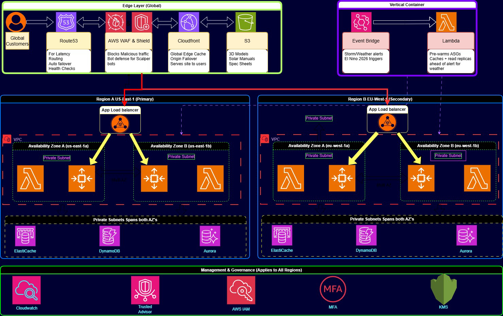

# Global 3D E-Commerce Platform Architecture 
## Selling EcoFlow Portable Power & Solar Systems

> [!NOTE]
> **📋 Project:** AWS Global 3D E-Commerce Platform (EcoFlow Power & Solar)  
> **👨‍💻 Prepared By:** AWS re/Start Cloud Architecture Mini Team

---

## 📋 1. Executive Summary

### Architecture Core Goals & Business Case
Our team is launching a next-generation 3D e-commerce platform specializing in **EcoFlow Portable Power & Solar Systems**. We chose this product line because severe weather and power grid instability are global phenomena intensified by the **2026 El Niño** (hurricanes in the US, typhoons in Asia, load-shedding in Africa, winter storms in Europe).

When outages hit, they trigger sudden, unpredictable traffic surges from panicked buyers. Furthermore, high-ticket battery spec sheets and heavy solar manuals require real bandwidth. This business case justifies our need for AWS Auto Scaling, heavy S3/CloudFront asset caching, and AWS WAF bot defense for high-value orders.

The architecture meets five core requirements:

1. **High Availability:** 24/7 uptime with automated failover across US-East-1 and EU-West-1.
2. **Scalability:** Dynamic handling of unpredictable, weather-driven traffic spikes.
3. **Performance:** Fast delivery of 3D models and 50MB+ solar manuals via edge caching.
4. **Security:** Defense-in-depth to protect high-value transactions from scalper bots.
5. **Cost Optimization:** Auto-scaling and managed services to avoid over-provisioning during calm weather periods.

_You can view the Assignment Brief here:_ [Design a 3D architecture.pdf](./Documentation/Design%20a%203D%20architecture.pdf)

---

## ⚡ 2. High-Level Architecture Diagram

*Figure 1. EcoFlow global multi-region architecture: active in US-East-1 and EU-West-1, with the load balancer, Auto Scaling Group and data tier spanning two Availability Zones per region.*

The architecture features a global edge layer (Route 53, WAF & Shield, CloudFront, S3) routing users to two active AWS Regions: **Region A (US-East-1 Primary)** and **Region B (EU-West-1 Secondary)**. Both regions contain identical, highly available VPC setups across two Availability Zones (a private subnet in each), fronted by an Application Load Balancer that spans both zones. The EC2 Auto Scaling Group spans both zones, and Lambda functions run inside the VPC. Aurora (primary read/write, secondary read-only / failover) and DynamoDB Global Tables (read/write in both regions) replicate data across regions, while ElastiCache is deployed in both regions to cache frequently accessed data.

An event-driven layer (**EventBridge + Lambda**) manages pre-warming of Auto Scaling Groups and caches based on external triggers such as storm and weather alerts. CloudWatch, Trusted Advisor, IAM, MFA and KMS form a management and governance layer that applies to all regions.

---

## 🌐 3. Network Architecture & Service Breakdown

### 3.1 Edge & Content Delivery Tier

| Service | Role in the architecture |
| :--- | :--- |
| **Amazon Route 53** | **Latency Routing** directs global buyers to the closest region, with **Auto Failover** and **Health Checks** for regional outages. CloudFront then serves buyers from the nearest edge location, including during a localized storm. |
| **Amazon CloudFront** | Global edge caching layer. 90%+ of static requests (50MB solar wiring diagrams, 3D battery spec sheets) are served from local edge locations, preventing core EC2 web servers from being overwhelmed by heavy media. |
| **Amazon S3** | Stores 3D product models, high-resolution images and heavy solar manuals with multi-region storage, ensuring high durability and fast access for CloudFront. |
| **AWS WAF & Shield** | Deployed at the edge to inspect and block malicious traffic. Critical for **bot defense**, stopping scalper bots from exploiting high-demand emergency sales before traffic reaches the main AWS region. |

### 3.2 Compute & Web Tier (VPC - Both Regions)

| Service | Role in the architecture |
| :--- | :--- |
| **EventBridge + Lambda (Pre-warming)** | EventBridge rules react to external triggers, specifically **storm and weather alerts (El Niño triggers)** ingested through scheduled checks or API integrations. A rule invokes a Lambda function to pre-warm Auto Scaling Groups, cache data, and prepare infrastructure for the impending traffic surge. |
| **Application Load Balancer** | Distributes incoming traffic across multiple targets within the VPC. |
| **EC2 Auto Scaling Groups** | Deployed across two Availability Zones (**us-east-1a and us-east-1b** in Region A; equivalent in Region B) for fault tolerance. Directly handles unpredictable traffic surges when power outages occur. |
| **AWS Lambda** | Runs serverless backend functions within the VPC, complementing EC2 instances for event-driven processing. |
| **Private Subnets** | All compute and database resources are isolated in private subnets, enhancing security. |

### 3.3 Data & Storage Tier (Multi-Region)

| Service | Role in the architecture |
| :--- | :--- |
| **Aurora Global Database** | Relational database for customer data and high-value transactions, with sub-second replication and low-latency global reads. Primary region is **read/write**; secondary region is **read-only / failover**. |
| **DynamoDB Global Tables** | NoSQL database for the product catalog (EcoFlow inventory) and user sessions, configured **read/write in both regions** to allow multi-active application logic. |
| **Amazon ElastiCache** | Deployed in both VPCs to cache frequently accessed data, reducing database load and improving 3D rendering response times. |

---

## 🔒 4. Multi-Layer Security Architecture

Security is integrated at every layer, following the AWS Shared Responsibility Model.

| Layer | Controls |
| :--- | :--- |
| **Edge Security** | WAF & Shield protect against SQL injection, XSS and DDoS attacks, and block scalper bots targeting high-demand emergency sales of EcoFlow units. |
| **Network Security** | VPCs segmented into public and private subnets. Databases and backend compute reside in private subnets, inaccessible from the internet. Security Groups act as virtual firewalls. |
| **Identity & Access** | IAM roles and Multi-Factor Authentication (MFA) ensure only authorized personnel and services can interact with the infrastructure. |
| **Data Encryption** | KMS encrypts data at rest (S3, Aurora, DynamoDB) and in transit (TLS/SSL), protecting customer payment information and high-value order details. |

---

## 💰 5. Cost-Benefit & Financial Optimization

### CapEx vs. OpEx Transformation
By leveraging AWS cloud services, we eliminate large upfront Capital Expenditure (CapEx) for physical servers, shifting to a variable Operational Expenditure (OpEx) model. We only pay for what we use.

### Cost Efficiency Drivers
- **Auto-Scaling:** avoids over-provisioning by scaling down in calm weather and scaling up only when storms hit.
- **CloudFront Caching:** serving 90%+ of heavy solar manuals from the edge significantly reduces data transfer costs and backend compute load.
- **Serverless (Lambda):** pay only for compute time used for event-driven tasks such as pre-warming, eliminating idle server costs.
- **Trusted Advisor:** continuously monitors utilization and recommends removing unused resources and right-sizing instances.

---

## ⚖️ 6. Architectural Trade-Offs & Decisions

| Decision | Trade-off and rationale |
| :--- | :--- |
| **Multi-Region Active-Active** | Offers the lowest latency and highest availability for global storm events, but introduces data consistency challenges. DynamoDB Global Tables accepts writes in both regions and resolves conflicts automatically, while Aurora Global Database keeps a single writer in the primary region, with the secondary region read-only and ready for failover. |
| **Event-Driven Pre-warming** | Adds architectural complexity (EventBridge and Lambda logic), but the cost is negligible compared to lost revenue and customer trust if servers crashed during a hurricane or load-shedding event. |
| **Serverless (Lambda) vs. EC2** | Hybrid approach: EC2 Auto Scaling handles steady-state web traffic and heavy 3D rendering, while Lambda handles event-driven tasks. Balances cost-efficiency with control for heavy compute workloads. |

---

## 🌪️ 7. Special Scenario: Impact of the 2026 El Niño

The current El Niño is forecast to be one of the strongest on record, peaking around December 2026. For the EcoFlow platform this is a **stress test** for the architecture and a significant business opportunity.

### The Direct Impact: A Surge in Global Demand

| Region | Possible conditions |
| :--- | :--- |
| **US & California** | Damaging storms, floods and widespread power outages are possible. |
| **Asia** | Unseasonal heatwaves and potential hydropower declines could cause grid instability. |
| **Africa** | Drought in parts of southern Africa raises the risk of load-shedding (other regions may see heavy rain instead). |
| **Europe** | Winter storms could cause localized grid failures, though the El Niño link is weaker and less certain. |

Traffic spikes may no longer be isolated to one region; they could be **global and simultaneous**.

### How Our Architecture Responds

1. **Edge Layer (Route 53 & CloudFront):** When a storm hits the US East Coast, CloudFront serves buyers from the closest edge location, absorbing 90%+ of the demand for 50MB wiring diagrams before it reaches the backend, while Route 53 latency routing sends dynamic requests to the closest healthy region.
2. **Pre-Warming Layer (EventBridge & Lambda):** The **proactive** advantage: on a severe weather warning, Lambda pre-warms the Auto Scaling Groups so EC2 capacity is ready *before* landfall, avoiding cold starts.
3. **Compute Layer (Auto Scaling):** For spikes without a weather trigger, ASGs add instances across multiple AZs, then scale back down when the surge subsides.
4. **Data Layer (Aurora & DynamoDB):** The multi-region database setup keeps reads fast worldwide, accepts DynamoDB writes in both regions, and supports failover if a region has issues.
5. **Security Layer (WAF & Shield):** Emergency sales are a prime target for scalper bots. WAF blocks malicious traffic at the edge so legitimate customers can complete purchases.

### Proactive Adjustments for Peak Season (Nov 2026 - Jan 2027)
- **Refine pre-warming triggers:** tie EventBridge rules to the most reliable weather alert APIs for high-risk regions.
- **Stress-test Auto Scaling:** run load tests simulating a 1000% increase in concurrent users to validate scaling policies.
- **Monitor database replication:** configure CloudWatch Alarms to alert on cross-region replication latency.
- **Leverage Trusted Advisor:** check for service limit issues (EC2 limits, S3 request rates) that could become bottlenecks.

---

## 🏛️ 8. AWS Well-Architected Framework Alignment

| Pillar | How our architecture achieves it |
| :--- | :--- |
| **Operational Excellence** | CloudWatch monitoring, Trusted Advisor and automated scaling reduce manual intervention during global weather events. |
| **Security** | WAF bot defense, Shield, IAM, MFA, KMS encryption and private subnets implement defense-in-depth for high-value orders. |
| **Reliability** | Multi-AZ and multi-region deployments, Aurora Global Database, DynamoDB Global Tables and automated failover ensure 24/7 availability during outages. |
| **Performance Efficiency** | CloudFront edge caching absorbs traffic spikes, Route 53 Latency Routing directs buyers to the closest region, and ElastiCache speeds up database queries. |
| **Cost Optimization** | Auto Scaling, serverless Lambda, managed services and Trusted Advisor prevent over-provisioning during calm weather. |
| **Sustainability** | Auto-scaling reduces idle resources, and managed services optimize energy efficiency in AWS data centers. |

_You can view the Final Report Submission here:_ [EcoFlow_Architecture_171026.pdf](./Documentation/EcoFlow_Architecture_171026.pdf)
