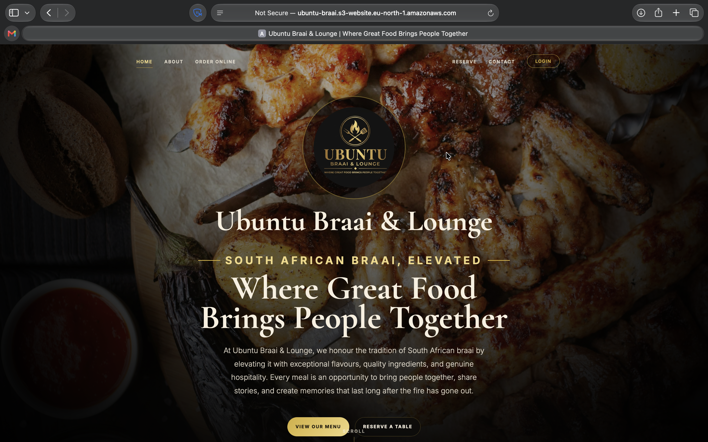
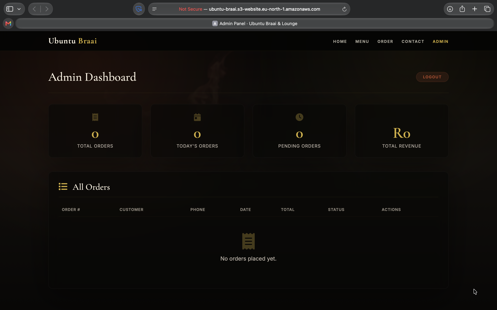

# Ubuntu Braai & Lounge: Static Restaurant Website on AWS
## A Low-Cost Ordering and Reservation Website Hosted on Amazon S3

> [!NOTE]
> **📋 Project:** AWS re/Start Special Project 1: Building a Static Website for a Restaurant and Presenting AWS Migration Benefits  
> **👨‍💻 Prepared By:** AWS re/Start Project Group 8 Mini Team

---

## 📋 1. Project Overview

### The Business Problem
The brief asked the team to build a static website for a restaurant that was struggling with a high volume of bookings and orders. With a manual process of paper records, phone calls and email, orders were getting mixed up, bookings were being double-booked, and the owner had no central way to track customers or confirmations.

### Our Solution
We built **Ubuntu Braai & Lounge**, a static website where customers can browse the menu, place orders and make reservations online. The site is built with HTML5, CSS3 and JavaScript and is hosted on **Amazon S3**, which keeps hosting costs very low and makes menu updates quick.

Alongside the working website, the team designed a phased AWS architecture that shows how the site could grow into a full serverless solution as the restaurant grows. The design is built around three principles:

1. **Affordable:** AWS Free Tier and pay-as-you-go services suit a small business budget.
2. **Reliable:** S3 hosting removes the need for a server to maintain, and versioning protects against accidental changes.
3. **Scalable:** serverless services can be added only when the business needs them.

_You can view the Assignment Brief here:_ [Project 1 Building a Static Website and Presenting AWS Migration Benefits.pdf](./Documentation/Project_1_Building_a_Static_Website_and_Presenting_AWS_Migration_Benefits.pdf)

---

## 🌐 2. Live Website

*Figure 1. The Ubuntu Braai & Lounge homepage, hosted on Amazon S3.*

| Page | Link |
| :--- | :--- |
| **Customer website** | [Open the Ubuntu Braai & Lounge website](http://ubuntu-braai.s3-website.eu-north-1.amazonaws.com/index.html) |
| **Admin dashboard** | [Open the admin dashboard](http://ubuntu-braai.s3-website.eu-north-1.amazonaws.com/admin.html) (Password Protected) |

>[!Caution]
> The Admin dashboard is password protected, when prompted insert: `ubuntu2026`

The website was fully coded and deployed to an Amazon S3 bucket in the **eu-north-1 (Stockholm)** region.

---

## 🏗️ 3. Architecture

The solution uses a layered architecture that separates the customer interface, website hosting and future backend services.

### 3.1 Current Architecture (Deployed)

| Component | Purpose |
| :--- | :--- |
| **Customer** | Browses the menu, places orders and makes reservations. |
| **Web Browser** | Displays the website and sends requests. |
| **HTML5** | Provides the structure of each page. |
| **CSS3** | Creates the responsive layout and branding. |
| **JavaScript** | Handles navigation, the shopping cart, form validation and local storage. |
| **Amazon S3** | Hosts the static website files at low cost. |

### 3.2 Future Architecture (Planned)

These services are part of the proposed design and are not yet deployed.

| Service | Purpose |
| :--- | :--- |
| **Amazon Cognito** | Customer and staff login. |
| **Amazon API Gateway** | Receives secure requests from the website. |
| **AWS Lambda** | Processes orders and reservations. |
| **Amazon DynamoDB** | Stores orders and reservations using pay-as-you-go pricing. |
| **Amazon SES** | Sends confirmation emails. |
| **Amazon SQS** | Queues orders during busy periods. |
| **Amazon CloudFront** | Improves website loading speed through caching. |
| **AWS Budgets** | Tracks monthly AWS spending. |
| **Amazon CloudWatch** | Monitors the application and logs errors. |

---

## 🧩 4. Challenges & AWS Solutions

| Challenge | AWS Services | How the challenge is addressed |
| :--- | :--- | :--- |
| **High order volumes** | SQS, Lambda | Queues requests and processes them automatically. |
| **Menu updates** | Amazon S3 | Website files are updated quickly at low cost. |
| **Reservation conflicts** | Lambda, DynamoDB | Checks availability before confirming bookings. |
| **Customer communication** | Amazon SES | Sends affordable confirmation emails. |
| **Static website limitations** | API Gateway, Lambda | Adds dynamic functionality only when needed. |
| **Security** | IAM | Restricts access to AWS resources. |
| **Performance** | CloudFront | Improves loading speed by caching content. |
| **Cost management** | AWS Budgets | Alerts when spending approaches the budget. |
| **Monitoring** | CloudWatch | Tracks health and application logs. |
| **Backup & recovery** | S3 Versioning | Recovers deleted or overwritten files. |

---

## 🔒 5. Security & POPIA Compliance

To help protect customers' personal information under South Africa's Protection of Personal Information Act (POPIA), the proposed design uses a small set of affordable controls:

| Control | Role |
| :--- | :--- |
| **HTTPS with AWS Certificate Manager (ACM)** | Secures data sent over the internet. |
| **IAM** | Controls who can access AWS resources. |
| **Amazon S3 encryption** | Protects stored files. |
| **Amazon CloudWatch** | Monitors activity. |

Together these support POPIA requirements without increasing costs unnecessarily.

---

## 📝 6. Project Approach

The team held a planning session on **11 July 2026**. By that point the website had already been fully coded and deployed to Amazon S3, so the session focused on the second deliverable, the group presentation on the benefits of migrating to AWS. The team agreed to split the presentation into these sections:

1. **Website Architecture:** how the site meets the business requirements, illustrated with screenshots.
2. **AWS Architecture Diagrams:** workflows for storage, database, compute and notification services (order placement, table reservation, order confirmation, daily sales summary and inventory summary), with a justification for each service.
3. **Challenges:** the problems the business could face when replicating its current processes on AWS, and within the chosen architecture.
4. **Benefits of Cloud Migration:** why moving to the cloud suits the business.
5. **Cost Analysis:** a comparison of the cloud solution against the business's operating costs before migration, using the AWS Pricing Calculator.

_You can view the planning notes here:_ [Project 01 Planning Meeting.pdf](./Documentation/Project01_Planning_Meeting.pdf)

---

## ✅ Conclusion

By combining secure authentication, monitoring, scalable serverless services and low-cost storage, the Ubuntu Braai & Lounge solution addresses the identified business and technical challenges while remaining affordable for a small business. The selected AWS services provide a practical foundation that can be expanded as the restaurant grows.

_You can view the Final Report Submission here:_ [Ubuntu Website Architecture.pdf](./Documentation/Ubuntu_Website_architecture.pdf)
